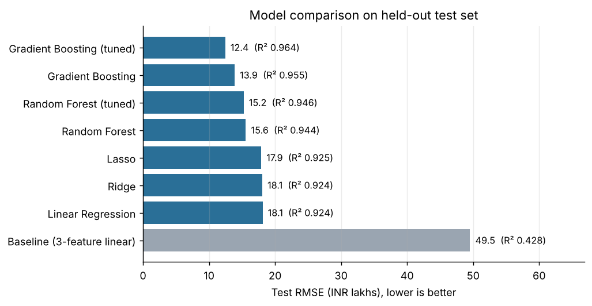
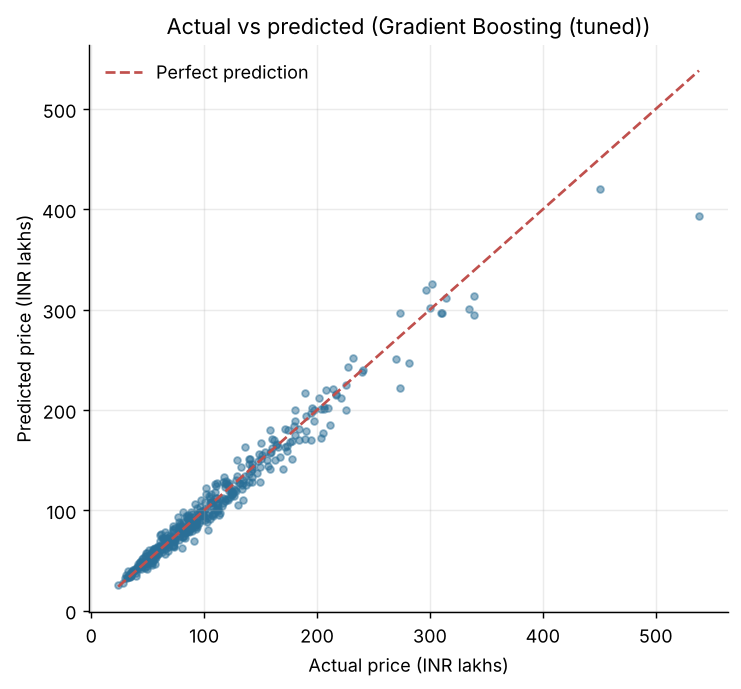
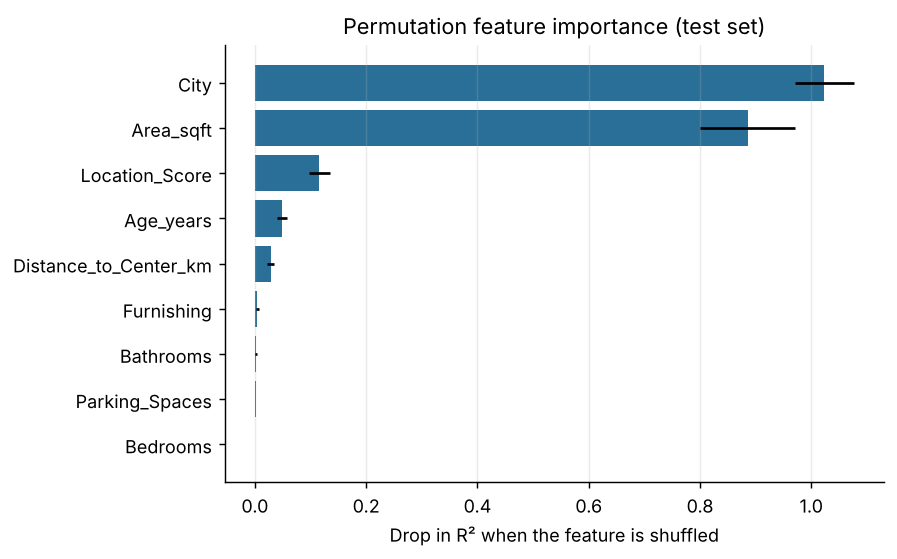

# House Price Prediction
**Live demo:** [house-price-predict-one.streamlit.app](https://house-price-predict-one.streamlit.app)

> **Note:** This is a demo model trained on *simulated* data built around published 2026 asking-price benchmarks for 9 Indian cities (121 localities). Estimates are illustrative, not a market valuation. Asking prices are usually higher than final sale prices.
An end-to-end machine-learning project that predicts house prices (in INR lakhs) from property features. It started as a 3-feature linear regression and was extended into a full pipeline: more features, preprocessing, model comparison, cross-validation, hyperparameter tuning, explainability, a prediction CLI, unit tests and a small web app.



## Results

Evaluated on a held-out test set of 400 houses (80:20 split). The best model was chosen using 5-fold cross-validation on the training set only, so the test set stays unbiased.

| Model | CV RMSE | Test RMSE (lakhs) | Test MAE | Test R² |
|-------|--------:|------------------:|---------:|--------:|
| Baseline: 3-feature linear regression | 52.8 | 49.5 | 35.2 | 0.428 |
| Linear Regression | 23.6 | 18.1 | 10.4 | 0.924 |
| Ridge | 23.5 | 18.1 | 10.4 | 0.924 |
| Lasso | 23.3 | 17.9 | 10.4 | 0.925 |
| Random Forest (tuned) | 18.9 | 15.2 | 9.9 | 0.946 |
| **Gradient Boosting (tuned)** | **12.7** | **12.4** | **7.6** | **0.964** |

The tuned Gradient Boosting model reduces test RMSE by about **75%** compared with the original 3-feature linear baseline (MAPE 7.0%). Full numbers are in `reports/model_comparison.csv` and `reports/metrics.json`.

| | |
|---|---|
|  |  |

City and area drive most of the price, followed by location score, age and distance from the centre. Bedroom count adds almost nothing once area is known, since the two are strongly correlated.

## What the project does

- **Data**: 2,000 houses across 5 cities with 9 features (area, bedrooms, bathrooms, age, location score, distance to centre, parking, city, furnishing). Roughly 6% of rows have missing values.
- **Preprocessing**: median imputation and scaling for numeric columns, most-frequent imputation and one-hot encoding for categorical ones, all inside a single scikit-learn `Pipeline` so there is no data leakage.
- **Target transform**: models are trained on `log(price)` because prices are right-skewed, then converted back to lakhs.
- **Models**: Linear, Ridge, Lasso, Random Forest, Gradient Boosting, compared with 5-fold cross-validation.
- **Tuning**: `GridSearchCV` on Random Forest and Gradient Boosting.
- **Explainability**: permutation feature importance, residual analysis, actual-vs-predicted plots.
- **Tests**: `pytest` suite covering data generation, the pipeline, missing/unseen inputs and prediction sanity checks.

## About the data

No real housing dataset is bundled. The data is **synthetic**, generated in `house_price/data.py` with a realistic structure (price per sq. ft depends on city, neighbourhood, age, distance and furnishing, plus noise). The scores therefore show that the pipeline recovers the pattern built into the data, not how it would perform on a real market. Swapping in a real CSV with the same columns is the main next step.

## Project structure

```
house-price-prediction/
├── house_price/
│   ├── config.py      # paths, feature lists, constants
│   ├── data.py        # synthetic dataset generation / loading
│   ├── modeling.py    # preprocessing pipeline, models, metrics
│   ├── plots.py       # figures
│   ├── train.py       # training, CV, tuning, evaluation
│   └── predict.py     # predict a single house from the command line
├── tests/             # pytest unit tests
├── app.py             # Streamlit web app
├── data/house_data.csv
├── reports/           # metrics.json, model_comparison.csv, figures/
└── requirements.txt
```

## Getting started

```bash
pip install -r requirements.txt

python -m house_price.train            # trains, tunes, saves model + reports (~1 min)
python -m house_price.train --no-tune  # faster run without grid search
python -m pytest                       # run the tests
```

Predict a single house:

```bash
python -m house_price.predict --area 1500 --bedrooms 3 --bathrooms 2 \
    --age 5 --location-score 7.5 --distance 6 --parking 1 \
    --city Bengaluru --furnishing Semi-furnished
```

Run the web app (after training):

```bash
streamlit run app.py
```

## Tech stack

Python, NumPy, Pandas, scikit-learn, Matplotlib, Streamlit, pytest

## Future work

- Train on a real housing dataset and compare with the synthetic results
- Try XGBoost / LightGBM and stacking
- Add SHAP explanations and prediction intervals
- Deploy the web app

## Author

Shubham, B.Tech Mathematics & Computing, Delhi Technological University
